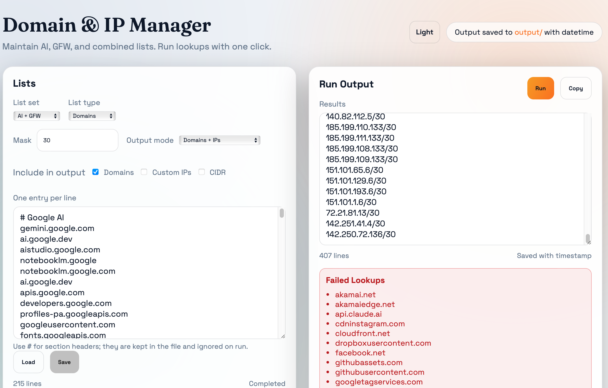

[English](README.md) · [العربية](i18n/README.ar.md) · [Español](i18n/README.es.md) · [Français](i18n/README.fr.md) · [日本語](i18n/README.ja.md) · [한국어](i18n/README.ko.md) · [Tiếng Việt](i18n/README.vi.md) · [中文 (简体)](i18n/README.zh-Hans.md) · [中文（繁體）](i18n/README.zh-Hant.md) · [Deutsch](i18n/README.de.md) · [Русский](i18n/README.ru.md)


[](https://lazying.art)

# DomainAndIpManager


A Python toolkit for maintaining curated domain/IP/CIDR list sets, resolving DNS to deterministic IP blocks, deduplicating, and exporting reproducible snapshots for routing and filtering workflows.

| Focus | Details |
|---|---|
| Domain sets | `ai`, `gfw`, `ai_gfw`, `gfw_wo_ai`, `non_gfw`, `default` |
| Core workflows | DNS resolution, deterministic merging, normalization, export |
| Output artifacts | Timestamped TXT plus JSON snapshots in `output/` |
| Interfaces | CLI scripts + Flask GUI (`code/gui_app.py`, served locally) |
| Data format | Line-based domain/IP/CIDR text files in `data/` |

---

## 🧭 Table of Contents

- [Overview](#-overview)
- [Features](#-features)
- [Project Structure](#-project-structure)
- [Prerequisites](#-prerequisites)
- [Installation](#-installation)
- [Usage](#-usage)
- [Configuration](#-configuration)
- [Scripts & Workflow Map](#-scripts--workflow-map)
- [Examples](#-examples)
- [Development Notes](#-development-notes)
- [Troubleshooting](#-troubleshooting)
- [Roadmap](#-roadmap)
- [Contributing](#-contributing)
- [Support](#️-support)
- [Contact](#-contact)
- [License](#-license)

## 🗂️ At a Glance

| Area | Details |
|---|---|
| Domain sets | `ai`, `gfw`, `ai_gfw`, `gfw_wo_ai`, `non_gfw`, `default` |
| Core workflows | DNS resolve + merge, dedupe/sort, GUI editing, snapshot export |
| Output formats | TXT + JSON |
| Primary output directory | `output/` |
| Primary entrypoints | CLI scripts under `code/`, Flask GUI in `gui_app.py` |

## 🚀 Overview

DomainAndIpManager is designed for repeatable list generation:

- Keep separate curated list sets in `data/` (domains + custom IPs + CIDR + mask files)
- Resolve domain names to IPs and convert to CIDR-style entries
- Merge resolved entries with custom/curated network blocks
- Export deterministic artifacts (TXT + JSON) with stable ordering and optional timestamped snapshots
- Run via CLI or launch the web GUI for interactive editing and regeneration

## ✨ Features

| Area | Details |
|---|---|
| Multi-list profiles | Separate list sets (`ai`, `gfw`, `ai_gfw`, `gfw_wo_ai`, `non_gfw`, `default`) for strategy-specific routing |
| DNS resolution | `code/nslookup*.py` scripts for domain → IP block expansion |
| Sorting / de-duplication | `code/unique_sort*.py` handles mixed domain/IP/CIDR normalization |
| Deterministic export | Stable TXT + JSON output ordering with optional timestamped snapshots |
| GUI editing | `gui/` for interactive editing of `domains`, `custom_ips`, `cidr`, and mask settings |
| Diagnostics | Optional failed-lookup reporting for troubleshooting resolvers |
| Optional OCR utility | `traffics/` helpers for YouTube/video extraction workflows |

---

## ✅ Prerequisites

| Requirement | Notes |
|---|---|
| Python | 3.10+ (recommended) |
| Network | Internet access for DNS lookups |
| Python packages | `pip` and dependencies from `requirements.txt` |
| Git | Required for cloning/updating the repository |
| OCR optional stack | `ffmpeg` + `tesseract` when using traffic extraction utility |

---

## 📦 Installation

```bash
python3 -m pip install -r requirements.txt
```

Quick setup:

```bash
git clone <your-fork-or-this-repo-url>
cd DomainAndIpManager
python3 -m pip install -r requirements.txt
```

> Assumption: No virtual-environment bootstrap is required for direct CLI usage; `start_gui.sh` can still create and use `.venv` automatically when preferred.

## 🧭 Usage

### GUI

```bash
./start_gui.sh
```

`start_gui.sh` starts `code/gui_app.py` and serves:

- URL: `http://127.0.0.1:5000`
- GUI-backed editing for list files
- On-demand generation and copy-ready output previews
- Automatic `.venv` creation and dependency install/update steps where needed

You can also run directly:

```bash
python3 code/gui_app.py
```

### CLI Reference

| Common task | Command |
|---|---|
| Resolve AI-focused domains | `python3 code/nslookup_simplified.py` |
| Resolve GFW-focused domains | `python3 code/nslookup_simplified_gfw.py` |
| Resolve GFW + AI merged domains | `python3 code/nslookup_simplified_gfw_w_ai.py` |
| Resolve GFW minus AI domains | `python3 code/nslookup_simplified_gfw_wo_ai.py` |
| Resolve base resolver path | `python3 code/nslookup.py` |
| Sort + dedupe lists into JSON | `python3 code/unique_sort.py -i domain_and_ips.txt -o output/domain_and_ips_unique_sorted.json` |
| Export canonical TXT/JSON | `python3 code/unique_sort_print.py` |

Notes:

- Output files are written with timestamp suffixes like `output/<script>_YYYYMMDD_HHMMSS.txt`.
- Sorting scripts support custom input/output paths via flags.

### Optional OCR Utility

```bash
python3 traffics/extract_youtube_traffic.py \
  --videos "traffics/ScreenRecording_02-03-2026 07-34-48_1.MP4" \
           "traffics/ScreenRecording_02-03-2026 07-36-29_1.MP4"
```

Requires `ffmpeg` and `tesseract` on `PATH`.

## ⚙️ Configuration

- Maintain one entry per line in all `data/` text files.
- `#` comment lines are ignored in current shared list loader logic.
- Per-list masks are stored in `data/<set>_mask.txt`.
- Current checked-in mask values are repository-specific and reflected by `data/*_mask.txt` contents.
- Input is resolved into deterministic deduplicated output order before writing.

### List Set Matrix

| List set | Domains file | Custom IPs file | CIDR file | Mask file |
|---|---|---|---|---|
| `ai` | `data/ai_domains.txt` | `data/ai_custom_ips.txt` | `data/ai_cidr.txt` | `data/ai_mask.txt` |
| `gfw` | `data/gfw_domains.txt` | `data/gfw_custom_ips.txt` | `data/gfw_cidr.txt` | `data/gfw_mask.txt` |
| `ai_gfw` | `data/ai_gfw_domains.txt` | `data/ai_gfw_custom_ips.txt` | `data/ai_gfw_cidr.txt` | `data/ai_gfw_mask.txt` |
| `gfw_wo_ai` | `data/gfw_wo_ai_domains.txt` | `data/gfw_wo_ai_custom_ips.txt` | `data/gfw_wo_ai_cidr.txt` | `data/gfw_wo_ai_mask.txt` |
| `non_gfw` | `data/non_gfw_domains.txt` | `data/non_gfw_custom_ips.txt` | `data/non_gfw_cidr.txt` | `data/non_gfw_mask.txt` |
| `default` | `data/default_domains.txt` | `data/default_custom_ips.txt` | `data/default_cidr.txt` | `data/default_mask.txt` |

## 🧰 Script & Workflow Map

| Script | Purpose |
|---|---|
| `code/nslookup.py` | Base domain/IP resolution runner |
| `code/nslookup_simplified.py` | AI-focused resolution + CIDR export |
| `code/nslookup_simplified_gfw.py` | GFW-focused resolution |
| `code/nslookup_simplified_gfw_w_ai.py` | Merged GFW + AI resolution |
| `code/nslookup_simplified_gfw_wo_ai.py` | GFW without AI resolution |
| `code/unique_sort.py` | Normalize + dedupe + JSON output |
| `code/unique_sort_print.py` | Print + write canonical TXT/JSON artifacts |
| `code/list_utils.py` | Shared loaders, masks, and list helpers |
| `code/gui_app.py` | Flask GUI backend |
| `traffics/extract_youtube_traffic.py` | Optional OCR helper for traffic extraction |
| `start_gui.sh` | Virtualenv bootstrap + dependency install + server startup |

## 🗂️ Project Structure

```text
DomainAndIpManager/
├── AGENTS.md
├── README.md
├── requirements.txt
├── start_gui.sh
├── code/
│   ├── gui_app.py
│   ├── list_utils.py
│   ├── nslookup.py
│   ├── nslookup_simplified.py
│   ├── nslookup_simplified_gfw.py
│   ├── nslookup_simplified_gfw_w_ai.py
│   ├── nslookup_simplified_gfw_wo_ai.py
│   ├── unique_sort.py
│   └── unique_sort_print.py
├── gui/
│   ├── index.html
│   ├── app.js
│   └── styles.css
├── data/
│   ├── *_domains.txt
│   ├── *_custom_ips.txt
│   ├── *_cidr.txt
│   └── *_mask.txt
├── output/
├── demos/
│   └── demo.png
├── figs/
│   └── banner.png
├── traffics/
│   └── extract_youtube_traffic.py
├── i18n/
│   └── localized README.md variants
└── .github/
    └── FUNDING.yml
```

## 🎬 Demo



## 🧾 Data Files

Data files are plain line-delimited text in `data/`:

```text
data/ai_domains.txt
data/ai_custom_ips.txt
data/ai_cidr.txt
data/ai_mask.txt
```

The same naming pattern applies to `gfw`, `ai_gfw`, `gfw_wo_ai`, `non_gfw`, and `default`.

## 🧪 Examples

Run one resolver directly:

```bash
python3 code/nslookup_simplified_gfw.py
```

Typical output style:

```text
domain.example.com
198.51.100.12/30
203.0.113.44/30
203.0.113.0/24
```

Sort a custom input file to JSON:

```bash
python3 code/unique_sort.py -i ./my_list.txt -o ./output/my_list_unique_sorted.json
```

## 🧪 Development Notes

- Shared loader and resolver helper logic lives in `code/list_utils.py`.
- Output writers use deterministic ordering for reproducible artifacts.
- The repository currently does not include an automated test framework.
- No `setup.py` / `pyproject.toml` is present; this is a script-first project.
- `.github/FUNDING.yml` and `figs/*` assets indicate donation/funding integration details.

## 🧯 Troubleshooting

- `Input file not found: domain_and_ips.txt`
  - Run `python3 code/unique_sort.py -i <path> -o <path>` with a valid input path, or ensure `domain_and_ips.txt` exists at repository root.
- DNS lookup timeouts or failures
  - Verify network connectivity and DNS access, then retry.
- GUI fails to start on port 5000
  - Confirm `flask` is installed and no process is already bound to `127.0.0.1:5000`.
- OCR utility errors
  - Verify `ffmpeg` and `tesseract` are installed and discoverable via `PATH`.

## 🗺️ Roadmap

- Add unit tests for parsing, mask application, and normalization utilities.
- Add clear CLI help text for all scripts and common flags.
- Provide a lock-file or reproducible environment definition for Python dependencies.
- Add export/preview indicators in GUI for failed DNS lookups and merged output diffs.

## 🤝 Contributing

Contributions are welcome. Preferred workflow:

1. Open an issue describing the problem or feature request.
2. Keep changes focused and reproducible.
3. Document expected command usage and output changes in your PR description.
4. Update `README.md` when behavior/commands change.

## ❤️ Support

| Donate | PayPal | Stripe |
| --- | --- | --- |
| [](https://chat.lazying.art/donate) | [](https://paypal.me/RongzhouChen) | [](https://buy.stripe.com/aFadR8gIaflgfQV6T4fw400) |

## 📬 Contact

- Open a GitHub issue for bug reports and feature requests.
- Prefer concise reproduction steps, expected output, and command context in issue reports.

## 📄 License

No `LICENSE` file is currently tracked at repository root in this snapshot.
